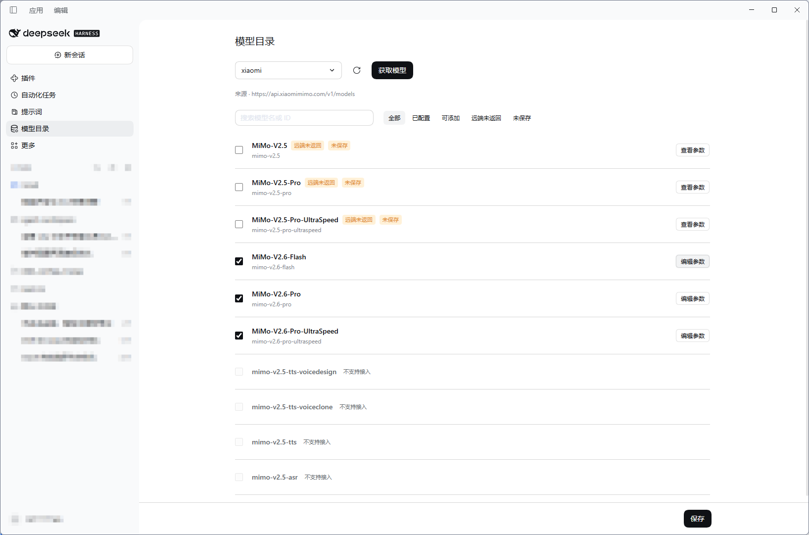

# Model Updater

[简体中文](README.md)

A provider has released a new model, but it is still missing from DSH? Fetch the provider's model list, compare it with your local configuration, and apply the changes you want.



## Installation and use

In DSH, open **Plugins → Add plugin** and enter the GitHub URL:

```text
https://github.com/norths7ar/dsh-model-updater
```

Once enabled, open **Model updater** from the sidebar, select a provider, and click **Fetch models**. Check the models you want to keep or add, edit their parameters as needed, then click **Save** to review and confirm your changes.

- Existing parameters are kept by default. When the provider returns different values, you can apply them individually. Use **Unsaved** to find models you have changed.
- After a complete fetch, existing models **Not returned** by the provider are unchecked by default and will be removed on save. Check them again to keep them.
- Specialized models for speech, image generation, embeddings, and similar tasks are marked **Not supported**.

Saving with all models unchecked asks you to confirm restoring the built-in models. This clears the custom model list and model overrides; it does not disable the provider.

## Compatibility

Verified with Xiaomi MiMo, OpenAI, and OpenCode Zen. Feedback from other providers is welcome.

| Plugin version | DSH Desktop version    |
| -------------- | ---------------------- |
| 0.1.0          | 0.2.2-rc.3, 0.2.2-rc.5 |

Which parameters this plugin can update depends entirely on what the provider returns. For example, MiMo's model endpoint returns model IDs but no context windows or output limits, so users need to enter those values manually.

Queries use the API key already configured in DSH and only fetch model lists, without calling inference endpoints. OpenCode Zen returns the model list for your account.

## Plugin limitations

Aggregators such as OpenCode Zen serve different models through different protocols. DSH needs to know which protocol each model uses to send requests correctly. These mappings are currently maintained in its **built-in** model table.

The plugin may find a new model in the provider's list before DSH's built-in table includes it. We encountered this with Gemini 4 Hydrogen: the model appeared in the list, but DSH lacked the protocol mapping needed to call it. DSH's current configuration interface does not let users **specify a protocol for an individual model**, so the plugin cannot fill this gap.

The author resolved this locally by modifying DSH's internal model table. However, application updates overwrite those changes, and modifying application files may have other effects, so the plugin does not modify these files on the user's behalf.

In the longer term, resolving this requires DSH to support model-level protocol configuration and allow its model table to be updated independently of application releases.

## Development

Tool versions are recorded in `.node-version`, `package.json`, and the lockfile.

```sh
npm ci
npm run check
npm pack --dry-run
```

`check` runs linting, formatting checks, and offline tests.

## License

[MIT](LICENSE)
