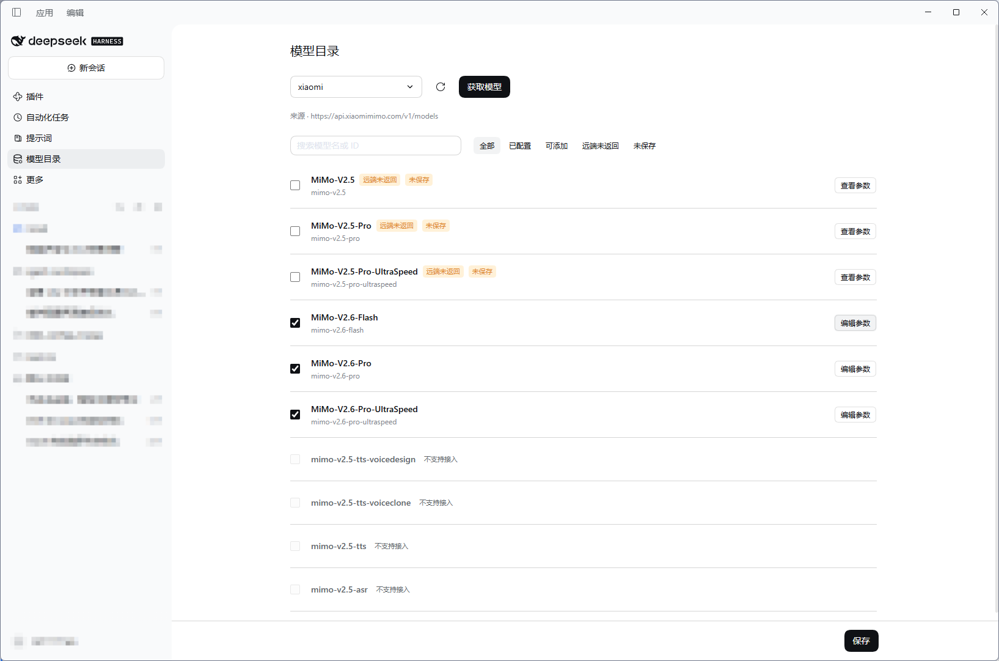

# 模型更新

[English](README.en.md)

提供商上线了新模型，DSH 里却还没有？从提供商获取模型列表，对比并更新本地模型配置。



## 安装与使用

在 DSH 的 **插件 → 添加插件** 中输入 GitHub 链接：

```text
https://github.com/norths7ar/dsh-model-updater
```

启用后，从侧栏打开 **模型更新**，选择提供商并点击 **获取模型**。勾选要保留或添加的模型，按需编辑参数，点击 **保存** 确认变更。

- 已有参数默认保留；提供商返回了不同的值时，可以逐项采用。改过的模型可通过 **未保存** 找回。
- 完整获取列表后，**远端未返回** 的已有模型默认取消勾选，保存后移除；需要保留时重新勾选即可。
- 语音、图像生成、Embedding 等专用模型会显示 **不支持接入**。

取消全部模型后保存，会先询问是否恢复内置模型。这会清除自定义模型列表和模型参数覆盖，不会停用提供商。

## 支持范围

目前已验证小米 MiMo、OpenAI 和 OpenCode Zen。其他提供商欢迎试用并反馈问题。

| 插件版本 | DSH Desktop 版本       |
| -------- | ---------------------- |
| 0.1.0    | 0.2.2-rc.3、0.2.2-rc.5 |

本插件能更新哪些参数完全取决于提供商返回的信息。例如 MiMo 的模型接口只返回型号，不提供上下文窗口和最大输出，此时就需要用户手动填写。

查询使用 DSH 中已有的 API Key，只获取模型列表，不调用推理接口。OpenCode Zen 返回的是账户对应的模型列表。

## 插件局限

OpenCode Zen 这类聚合提供商，会通过不同协议提供不同模型。DSH 需要知道每个型号使用哪种协议，才能正确发送请求；这些对应关系目前由它**内置**的模型数据表维护。

我们的插件可能已经从提供商查到了新型号，但 DSH 的内置表还没有收录。例如我们遇到的 Gemini 4 Hydrogen：型号能够查到，却缺少调用所需的协议对应关系。DSH 当前的配置接口不允许用户**为单个模型指定协议**，因此插件无法补齐这一步。

作者自己在本地通过修改 DSH 内部数据表解决了这个问题，但修改应用文件会被升级覆盖，也可能带来其他影响，所以插件不会替用户修改这些文件。

长期来看，想解决问题需要 DSH 开放模型级协议配置，并让模型数据表能够独立于应用版本更新。

## 开发

工具版本记录在 `.node-version`、`package.json` 和锁文件中。

```sh
npm ci
npm run check
npm pack --dry-run
```

`check` 包含 lint、格式检查和离线测试。

## 许可证

[MIT](LICENSE)
